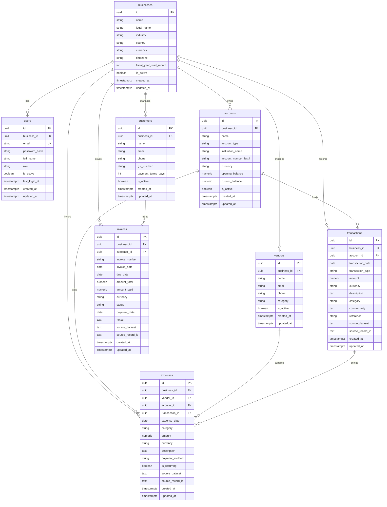

# AgentFi Canonical Database Schema (Day 2)

This document specifies the PostgreSQL canonical schema, conventions, and contracts implemented for AgentFi. It serves as the single source of truth for **Member 1 (Frontend)**, **Member 2 (Backend)**, **Member 3 (Data & Financial Intelligence)**, and **Member 4 (LangGraph Agents)**.

---

## 1. Entity Relationship (ER) Diagram



---

## 2. Global Schema Conventions

1. **Primary Keys**: Server-generated UUIDv4 using `gen_random_uuid()` (PostgreSQL built-in).
2. **Timestamps**: All timestamps use `timestamptz` (`TIMESTAMP WITH TIME ZONE`), defaulting to `now()`. `updated_at` is updated automatically.
3. **Monetary Precision**: All financial amounts use `NUMERIC(18, 2)`. Float is forbidden to avoid rounding errors.
4. **Positive Amounts**: Amounts are strictly stored as **positive values**. Flow direction is governed by `transaction_type` (`'inflow'` / `'outflow'`).
5. **Default Localization**: `currency` defaults to `'INR'` (ISO 4217), `country` defaults to `'IN'`, `timezone` defaults to `'Asia/Kolkata'`, and `fiscal_year_start_month` defaults to `4` (April).
6. **Enumerations**: Implemented as string columns with explicit PostgreSQL `CHECK` constraints (rather than native PG enums) for seamless future migrations without DDL locking.
7. **Multi-Tenancy & Tenant Isolation**: Every business domain table has a non-nullable `business_id UUID REFERENCES businesses(id) ON DELETE CASCADE` with an index on `business_id`.
8. **Data Provenance & Deduplication**:
   `transactions`, `invoices`, and `expenses` have nullable `source_dataset TEXT` and `source_record_id TEXT` columns with a partial unique index:
   ```sql
   CREATE UNIQUE INDEX uq_<table>_provenance ON <table> (business_id, source_dataset, source_record_id)
   WHERE source_dataset IS NOT NULL AND source_record_id IS NOT NULL;
   ```
   This prevents duplicate loads while allowing manual entries where source fields are `NULL`.

---

## 3. Table Definitions & Constraints

### 3.1 `businesses`
| Column | Type | Constraints & Defaults | Description |
| :--- | :--- | :--- | :--- |
| `id` | `UUID` | `PRIMARY KEY DEFAULT gen_random_uuid()` | Business tenant ID |
| `name` | `VARCHAR(255)` | `NOT NULL` | Operating business name |
| `legal_name` | `VARCHAR(255)` | `NULL` | Registered entity legal name |
| `industry` | `VARCHAR(100)` | `NULL` | Industry classification |
| `country` | `CHAR(2)` | `NOT NULL DEFAULT 'IN'` | ISO 3166-1 alpha-2 country |
| `currency` | `CHAR(3)` | `NOT NULL DEFAULT 'INR'` | ISO 4217 base currency |
| `timezone` | `VARCHAR(50)` | `NOT NULL DEFAULT 'Asia/Kolkata'` | IANA timezone string |
| `fiscal_year_start_month` | `INTEGER` | `NOT NULL DEFAULT 4 CHECK (1-12)` | Month starting the fiscal year |
| `is_active` | `BOOLEAN` | `NOT NULL DEFAULT true` | Active tenant flag |
| `created_at` / `updated_at` | `TIMESTAMPTZ` | `NOT NULL DEFAULT now()` | Audit timestamps |

### 3.2 `users`
| Column | Type | Constraints & Defaults | Description |
| :--- | :--- | :--- | :--- |
| `id` | `UUID` | `PRIMARY KEY DEFAULT gen_random_uuid()` | User ID |
| `business_id` | `UUID` | `NOT NULL REFERENCES businesses(id) ON DELETE CASCADE` | Tenant owner |
| `email` | `VARCHAR(255)` | `NOT NULL`, Unique on `lower(email)` | Login email address |
| `password_hash` | `VARCHAR(255)` | `NOT NULL` | Bcrypt password hash |
| `full_name` | `VARCHAR(255)` | `NULL` | User display name |
| `role` | `VARCHAR(20)` | `NOT NULL DEFAULT 'viewer' CHECK ('owner','admin','viewer')` | RBAC role |
| `is_active` | `BOOLEAN` | `NOT NULL DEFAULT true` | Active flag |
| `last_login_at` | `TIMESTAMPTZ` | `NULL` | Last login timestamp |
| `created_at` / `updated_at` | `TIMESTAMPTZ` | `NOT NULL DEFAULT now()` | Audit timestamps |

### 3.3 `accounts`
| Column | Type | Constraints & Defaults | Description |
| :--- | :--- | :--- | :--- |
| `id` | `UUID` | `PRIMARY KEY DEFAULT gen_random_uuid()` | Account ID |
| `business_id` | `UUID` | `NOT NULL REFERENCES businesses(id) ON DELETE CASCADE` | Tenant owner |
| `name` | `VARCHAR(100)` | `NOT NULL` | Account nickname |
| `account_type` | `VARCHAR(20)` | `NOT NULL CHECK ('bank','cash','credit_card','wallet')` | Account classification |
| `institution_name` | `VARCHAR(100)` | `NULL` | Bank / wallet issuer |
| `account_number_last4` | `VARCHAR(4)` | `NULL` (Never store full account numbers) | Last 4 digits |
| `currency` | `CHAR(3)` | `NOT NULL DEFAULT 'INR'` | Account currency |
| `opening_balance` | `NUMERIC(18,2)`| `NOT NULL DEFAULT 0.00` | Initial starting balance |
| `current_balance` | `NUMERIC(18,2)`| `NOT NULL DEFAULT 0.00` | Reconciled current balance |
| `is_active` | `BOOLEAN` | `NOT NULL DEFAULT true` | Account status |
| *Constraints* | | `UNIQUE(business_id, name)` | Account name uniqueness per tenant |

### 3.4 `customers`
| Column | Type | Constraints & Defaults | Description |
| :--- | :--- | :--- | :--- |
| `id` | `UUID` | `PRIMARY KEY DEFAULT gen_random_uuid()` | Customer ID |
| `business_id` | `UUID` | `NOT NULL REFERENCES businesses(id) ON DELETE CASCADE` | Tenant owner |
| `name` | `VARCHAR(255)` | `NOT NULL` | Customer organization / name |
| `email` | `VARCHAR(255)` | `NULL` | Contact email |
| `phone` | `VARCHAR(50)` | `NULL` | Contact phone |
| `gst_number` | `VARCHAR(50)` | `NULL` | GSTIN tax identifier |
| `payment_terms_days` | `INTEGER` | `NOT NULL DEFAULT 30` | Standard credit terms in days |
| `is_active` | `BOOLEAN` | `NOT NULL DEFAULT true` | Active flag |

### 3.5 `vendors`
| Column | Type | Constraints & Defaults | Description |
| :--- | :--- | :--- | :--- |
| `id` | `UUID` | `PRIMARY KEY DEFAULT gen_random_uuid()` | Vendor ID |
| `business_id` | `UUID` | `NOT NULL REFERENCES businesses(id) ON DELETE CASCADE` | Tenant owner |
| `name` | `VARCHAR(255)` | `NOT NULL` | Supplier / vendor name |
| `email` | `VARCHAR(255)` | `NULL` | Contact email |
| `phone` | `VARCHAR(50)` | `NULL` | Contact phone |
| `category` | `VARCHAR(100)` | `NULL` | Default expense category |
| `is_active` | `BOOLEAN` | `NOT NULL DEFAULT true` | Active flag |

### 3.6 `transactions`
| Column | Type | Constraints & Defaults | Description |
| :--- | :--- | :--- | :--- |
| `id` | `UUID` | `PRIMARY KEY DEFAULT gen_random_uuid()` | Transaction ID |
| `business_id` | `UUID` | `NOT NULL REFERENCES businesses(id) ON DELETE CASCADE` | Tenant owner |
| `account_id` | `UUID` | `NULL REFERENCES accounts(id) ON DELETE SET NULL` | Linked account |
| `transaction_date` | `DATE` | `NOT NULL` | Date of movement |
| `transaction_type` | `VARCHAR(10)` | `NOT NULL CHECK ('inflow','outflow')` | Cashflow direction |
| `amount` | `NUMERIC(18,2)`| `NOT NULL CHECK (amount > 0)` | Strictly positive value |
| `currency` | `CHAR(3)` | `NOT NULL DEFAULT 'INR'` | Currency code |
| `description` | `TEXT` | `NULL` | Transaction narrative |
| `category` | `VARCHAR(100)` | `NULL` | Financial category |
| `counterparty` | `TEXT` | `NULL` | Originating / destination entity |
| `reference` | `VARCHAR(100)` | `NULL` | Check / UTR / invoice reference |
| `source_dataset` / `record_id` | `TEXT` | `NULL` (Unique index on non-null pair) | ETL provenance tags |

### 3.7 `invoices`
| Column | Type | Constraints & Defaults | Description |
| :--- | :--- | :--- | :--- |
| `id` | `UUID` | `PRIMARY KEY DEFAULT gen_random_uuid()` | Invoice ID |
| `business_id` | `UUID` | `NOT NULL REFERENCES businesses(id) ON DELETE CASCADE` | Tenant owner |
| `customer_id` | `UUID` | `NULL REFERENCES customers(id) ON DELETE SET NULL` | Recipient customer |
| `invoice_number` | `VARCHAR(100)` | `NOT NULL` | Invoice code (e.g. INV-001) |
| `invoice_date` | `DATE` | `NOT NULL` | Issue date |
| `due_date` | `DATE` | `NOT NULL CHECK (due_date >= invoice_date)` | Due date |
| `amount_total` | `NUMERIC(18,2)`| `NOT NULL CHECK (amount_total >= 0)` | Gross invoice total |
| `amount_paid` | `NUMERIC(18,2)`| `NOT NULL DEFAULT 0.00 CHECK (>=0 AND <= total)` | Cumulative settled amount |
| `currency` | `CHAR(3)` | `NOT NULL DEFAULT 'INR'` | Currency code |
| `status` | `VARCHAR(20)` | `NOT NULL DEFAULT 'sent' CHECK in statuses` | Invoice state |
| `payment_date` | `DATE` | `NULL` | Final settlement date |
| *Note on 'overdue'* | | Computed dynamically by Member 3's finance engine | DB status is a snapshot |

### 3.8 `expenses`
| Column | Type | Constraints & Defaults | Description |
| :--- | :--- | :--- | :--- |
| `id` | `UUID` | `PRIMARY KEY DEFAULT gen_random_uuid()` | Expense ID |
| `business_id` | `UUID` | `NOT NULL REFERENCES businesses(id) ON DELETE CASCADE` | Tenant owner |
| `vendor_id` | `UUID` | `NULL REFERENCES vendors(id) ON DELETE SET NULL` | Beneficiary supplier |
| `account_id` | `UUID` | `NULL REFERENCES accounts(id) ON DELETE SET NULL` | Payment account |
| `transaction_id` | `UUID` | `NULL REFERENCES transactions(id) ON DELETE SET NULL` | Bank match |
| `expense_date` | `DATE` | `NOT NULL` | Date of expense |
| `category` | `VARCHAR(100)` | `NOT NULL` | Operational category |
| `amount` | `NUMERIC(18,2)`| `NOT NULL CHECK (amount > 0)` | Positive expense cost |
| `currency` | `CHAR(3)` | `NOT NULL DEFAULT 'INR'` | Currency code |
| `payment_method` | `VARCHAR(20)` | `NULL CHECK ('cash','bank_transfer','card','upi','cheque','other')` | Method used |
| `is_recurring` | `BOOLEAN` | `NOT NULL DEFAULT false` | Recurring flag |

---

## 4. Contracts to Confirm (For Member 1 & Member 3 Alignment)

> [!IMPORTANT]
> The backend and database enforce the following contracts. Teammates must review and confirm compatibility:

1. **`transaction_type` allowed values**:
   - Strictly `'inflow'` (money received) and `'outflow'` (money spent).
   - Amounts are strictly positive `NUMERIC(18,2)` (never negative).
2. **`invoice.status` lifecycle values**:
   - Allowed values: `'draft'`, `'sent'`, `'partially_paid'`, `'paid'`, `'overdue'`, `'void'`.
   - *Finance Engine rule*: `'overdue'` is derived deterministically by Member 3's engine if `amount_paid < amount_total` and `current_date > due_date`. The stored DB column acts as an indexed snapshot.
3. **`expense.category` format**:
   - Free text `VARCHAR(100)` at the database level to allow SME flexibility. Member 3's categorization agent can map arbitrary bank narration to standard categories.
4. **Date formats**:
   - ISO 8601 strings in API payloads (`YYYY-MM-DD` for dates, `YYYY-MM-DDTHH:MM:SSZ` for timestamptz).

---

## 5. How Member 3 Loads Data (ETL Guidelines)

When loading imported datasets (CSV, bank statements, Tally exports):
1. **Always Set `business_id`**: Tenant isolation requires every record to be explicitly bound to the SME's `business_id`.
2. **Always Provide Provenance Tags**:
   - `source_dataset`: Identifier for the batch (e.g. `'tally_export_2026_q1'`, `'hdfc_statement_mar26'`).
   - `source_record_id`: Primary key from the source file (e.g. transaction reference ID, row index).
3. **Automatic Deduplication**:
   - The partial unique index `(business_id, source_dataset, source_record_id)` automatically rejects duplicate rows if an ETL script is re-run.
   - Use `INSERT ... ON CONFLICT DO NOTHING` or catch SQLAlchemy `IntegrityError` to safely skip duplicates.

